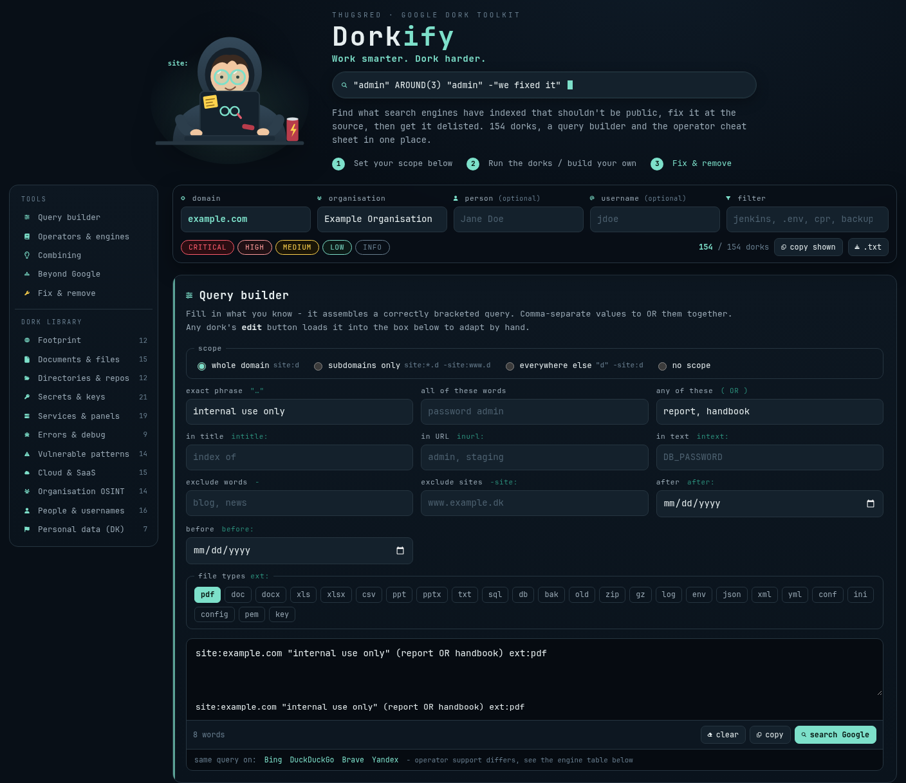
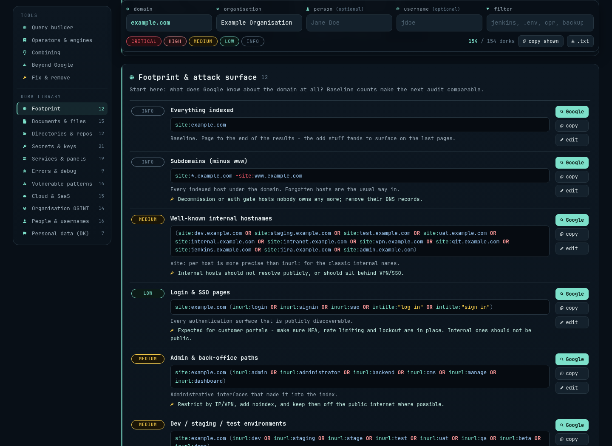
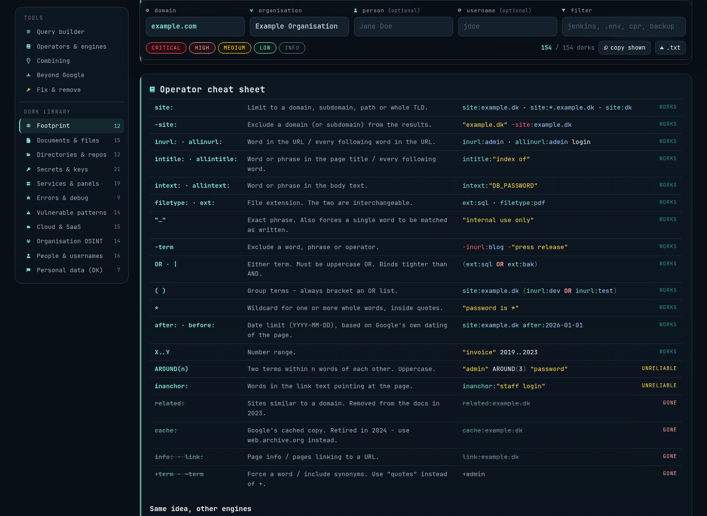

<p align="center">
  <a href="https://thugs.red"></a>
</p>

<h1 align="center">THUGSred Dorkify</h1>
<p align="center"><strong>Work smarter. Dork harder.</strong></p>
<p align="center">Google dork help, how-tos and a query builder.<br>A small, self-hosted web UI by the Danish hacking community <a href="https://thugs.red">THUGSred</a>.</p>

<p align="center">
  
  
  
  
  <a href="https://thugs.red"></a>
</p>

<p align="center">
  <a href="#quick-start">Quick start</a> ·
  <a href="#take-a-look">Screenshots</a> ·
  <a href="#whats-inside">Features</a> ·
  <a href="#configuration">Configuration</a> ·
  <a href="https://thugs.red">Community</a>
</p>

---

Set your scope, learn the search operators, and turn an idea into a query you
can copy or open in your search engine. Dorkify brings a searchable reference,
a visual builder, and practical exposure-remediation guidance into one page.

**Spin up Docker. Open the page. Start building.** No accounts, API keys,
database, package install or frontend build step. PHP renders the page;
JavaScript handles the interactive tools in your browser. Fonts, icons and
artwork ship with the app.

## Take a look

### Your scope. Your query.



<details>
<summary><strong>Explore the dork library</strong> — severity, explanations, remediation and one-click editing</summary>



</details>

<details>
<summary><strong>Learn the operators</strong> — examples and support notes in one place</summary>



</details>

*Captured from the running UI using example data. Personal scope fields are empty.*

## Quick start

Requires Docker with the Compose plugin.

```sh
git clone https://github.com/kawaiipantsu/thugsred-dorkify.git
cd thugsred-dorkify
docker compose up -d --build
```

Open **[http://localhost:8080](http://localhost:8080)**.

```sh
docker compose logs -f     # follow logs
docker compose down        # stop and remove the container
```

The image builds locally from `php:8.4-apache`. There is no separate image
registry, database or external API to configure.

## What's inside

| Tool | What you can do |
| --- | --- |
| **154 dorks · 11 categories** | Explore indexed files, directories, repository leftovers, exposed services, cloud storage, organisation footprints and more. Entries include severity, explanations and fixes where relevant. |
| **Scope & filters** | Apply a domain and organisation, optionally add a person or username, then filter by text and severity. Copy or export the visible queries. |
| **Query builder** | Combine exact phrases, any/all words, title/URL/text operators, file types, exclusions and dates. Edit any library query by hand. |
| **Search-engine links** | Open queries in Google, Bing, DuckDuckGo, Brave or Yandex. Operator support varies by engine. |
| **Operator reference** | Look up syntax, support notes, cross-engine equivalents and 14 patterns for combining operators. |
| **Beyond Google** | Follow scoped links to certificate transparency, web archives, code search and other exposure-review tools. |
| **Fix & remove** | Work through source fixes, credential rotation, indexing controls and removal requests. |

### A first query

1. Set **domain** to an asset you own or are authorised to review.
2. Choose a library entry, or fill in the **Query builder**.
3. Copy the query or open it in a search engine. Dorkify does not run searches in the background.
4. Use the entry's guidance and **Fix & remove** section to address any exposure.

For example, the builder can assemble:

```text
site:example.com "internal use only" (report OR handbook) ext:pdf
```

## Configuration

Copy the safe template before changing the bind address or port:

```sh
cp .env.example .env
```

| Variable | Default | Purpose |
| --- | --- | --- |
| `DORKIFY_PORT` | `8080` | Port published on the host. |
| `DORKIFY_BIND` | `0.0.0.0` | Interface to bind. Set `127.0.0.1` for local access or a reverse proxy on the same host. |

Then apply the settings with `docker compose up -d --build`. Local `.env`
files are ignored by Git and excluded from the Docker build context.

### Privacy & hosting

Scope values are saved in your browser's `localStorage` and the page URL.
Treat shared links, browser history and exported queries as assessment data.
Loading a shared URL can also put those values into web-server or proxy logs.
Clicking a search link sends that query to the selected search provider.

The container runs as `www-data` on port 8080 with a read-only filesystem,
dropped capabilities and `no-new-privileges`. Apache adds a Content Security
Policy, no-referrer policy, frame protection and noindex headers. Only
`src/public/` is served.

There is no built-in login. Add reverse-proxy authentication or a VPN when
access should be restricted. The default bind address exposes the page on
all host interfaces.

## Run without Docker

Use PHP 8.1 or newer with the `mbstring` extension:

```sh
make dev                   # http://127.0.0.1:8080
# or: php -S 127.0.0.1:8080 -t src/public
```

For an existing PHP web server, set its document root to `src/public/`.
The Apache settings in `docker/apache.conf` are specific to the container;
configure equivalent headers on your own server as needed.

### Export a static site

```sh
make static                # generated site in dist/
```

Upload the contents of `dist/` to a static web server. This runs the dork
linter and renders PHP into `index.html`, alongside the assets and fonts.
Generated output stays out of Git. Set privacy and security headers on the
static host; Apache's container configuration is not part of the export.

## Make it yours

| Path | Contents |
| --- | --- |
| [`src/lib/config.php`](src/lib/config.php) | Branding, version, repository and community links. |
| [`src/lib/dorks.php`](src/lib/dorks.php) | Dork categories and query templates. |
| [`src/lib/reference.php`](src/lib/reference.php) | Operators, combining patterns, engine table and related tools. |
| [`src/public/`](src/public/) | Page template, JavaScript, CSS, artwork and local fonts. |
| [`docker/`](docker/) | Apache and PHP configuration. |
| [`scripts/`](scripts/) | Dork linter and static export. |
| [`docs/screenshots/`](docs/screenshots/) | UI screenshots used in this README. |
| [`licenses/`](licenses/) | Required notices for the bundled fonts. |

A library entry looks like this:

```php
['t' => 'PDF documents', 's' => 'info',
 'q' => '{site} ext:pdf',
 'n' => 'PDF documents indexed for the scoped domain.',
 'f' => 'Review whether each document is intended to be public.'],
```

Supported placeholders: `{site}`, `{d}`, `{org}`, `{name}` and `{user}`.
Severities: `crit`, `high`, `med`, `low` and `info`. Write Nerd Font icons as
integer codepoints, such as `0xf084`.

```sh
make lint                  # validate all dork templates
make help                  # list available shortcuts
```

Keep credentials, local configuration, exports, logs and generated output
out of commits. `.gitignore` covers these common cases; review
`git diff --cached` before publishing changes.

## Community & credits

Made by **[THUGSred](https://thugs.red)**, the Danish hacking community.
Use Dorkify for learning and for assessments you are authorised to perform.

Code, mascot and logo: THUGSred. No project-wide license has been selected.
The bundled JetBrains Mono and Nerd Fonts assets retain their upstream
license notices in [`licenses/`](licenses/).
